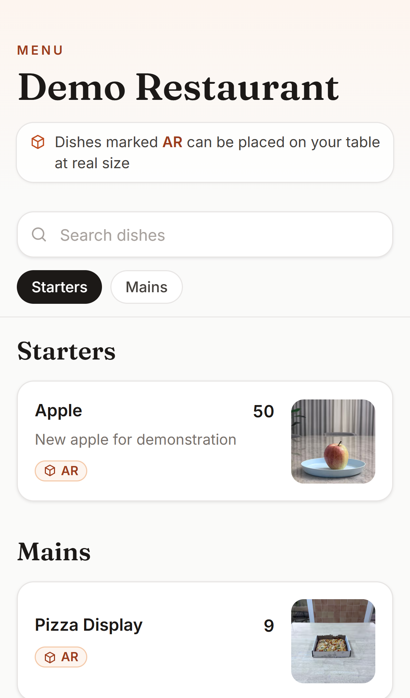
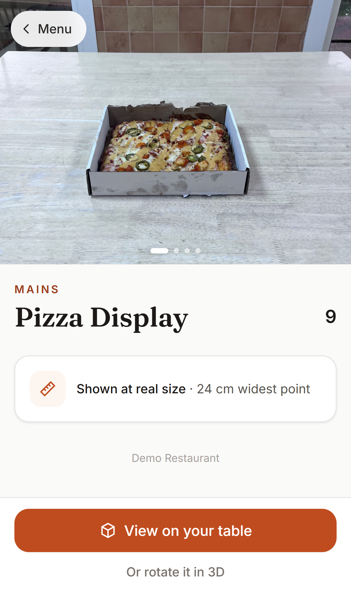
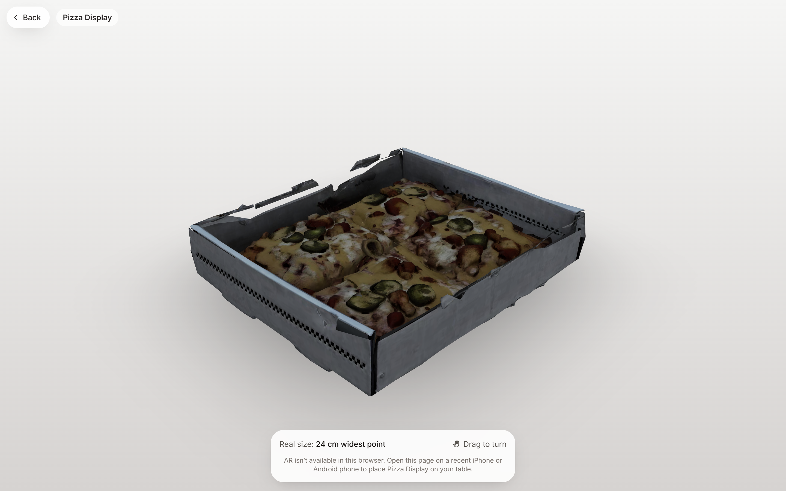
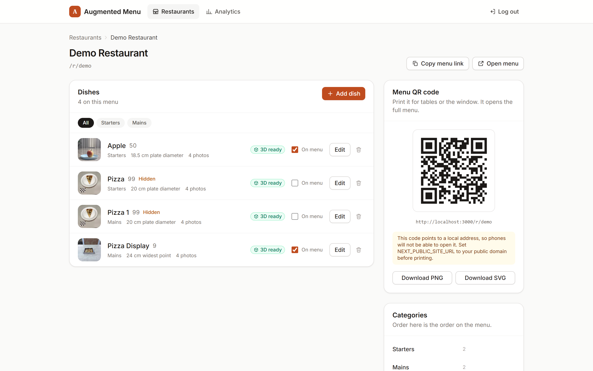

# Augmented Menu

A QR code menu where you can see each dish on your table in AR, at its actual size, before you order.

I built this because menu photos never tell you how big anything is. Is the sharing plate enough for two people or four? Is the dessert a bite or a slab? Here the restaurant takes four phone photos of a dish, the app turns them into a 3D model, and diners can drop it on their own table from the browser. No app to install.

<p>
  
  &nbsp;
  
</p>





More screenshots are in [docs/screenshots](docs/screenshots).

## What it does

For diners:

- Scan the QR code on the table and the menu opens in the browser.
- Open a dish and tap "View on your table". iPhones open AR Quick Look and Android phones open Scene Viewer, both in one tap.
- Laptops and phones without AR get a 3D viewer you can spin around instead.
- The model is scaled to the real plate, bowl or glass, so what you see is roughly what shows up.

For the restaurant:

- A small admin panel to create the menu, categories and dishes.
- Upload front, left, back and right photos of a dish and hit Generate 3D.
- Enter one measurement per dish (plate diameter, bowl diameter, glass height or max width).
- Download a QR code for the whole menu or for a single dish, as PNG or SVG.
- A simple analytics page: menu views, dish views, AR opens and placements.

## How it works

1. The admin uploads the photos and the dish size. The app puts a job on a Redis queue.
2. A separate worker sends the photos to the Tripo API, which builds a 3D model, then asks for a lighter low-poly version that loads fast on phones.
3. The worker measures the model with glTF-Transform and works out the scale from the real measurement. For a plate that is the width, for a glass it's the height.
4. It saves three files to Supabase Storage: a compressed GLB for the web viewer, a GLB with the scale baked in for Android, and a USDZ for iPhone.
5. The dish page checks what device you're on and picks the right one.

A couple of things that took some care. Tripo charges per task, so every task id is saved as soon as it's created. If the worker crashes or times out, the retry picks the old task back up instead of paying for a new one. Each generation also gets its own version number, so if an old job finishes late it can't overwrite a newer model.

## Numbers

I measured these against the real database and storage:

| What | Result |
| --- | --- |
| Model size with the low-poly step and quantization (same dish) | 41 MB to 1.9 MB, 95% smaller |
| glTF quantization on its own | about 21% smaller (median of 7 models) |
| Photos to AR-ready model | median 3.9 minutes, 9 of 9 jobs succeeded |
| Mobile menu download | 3.4 MB to 260 KB, main content shows 33% sooner |
| Web and iPhone models | same size within 0.35% |

## Tech stack

- Next.js 16 (App Router), React 19, TypeScript, Tailwind CSS
- three.js with react-three-fiber, drei and @react-three/xr for the 3D and WebXR viewer
- AR Quick Look on iOS and Scene Viewer on Android
- glTF-Transform for measuring, compressing and scaling models
- Tripo3D API for photos to 3D
- PostgreSQL with Prisma, Supabase Storage for files
- BullMQ on Redis for the background jobs
- node:test for the tests

## Running it locally

You need Node 20 or newer, a Postgres database, Redis, a Supabase project with a public storage bucket, and a Tripo API key if you want to actually generate models.

```bash
npm install
cp .env.example .env
npx prisma migrate deploy
npx prisma db seed
npm run dev
```

Fill in `.env` before the migrate step (see below). The seed is optional and creates a demo restaurant at `/r/demo`.

The app runs at http://localhost:3000 and the admin panel is at `/admin`. 3D generation happens in a separate process, so start the worker in a second terminal:

```bash
npm run worker
```

To run the checks:

```bash
npm run lint
npm run typecheck
npm test
```

## Environment variables

All of these go in `.env`. There's a commented example in `.env.example`.

| Variable | What it's for |
| --- | --- |
| `DATABASE_URL` | Postgres connection the app uses. On Supabase this is the pooled one on port 6543 with `?pgbouncer=true`. |
| `DIRECT_URL` | Direct Postgres connection for Prisma migrations (port 5432 on Supabase). |
| `ADMIN_PASSWORD` | Password for the admin panel. |
| `SESSION_SECRET` | Long random string used to sign the admin login cookie. |
| `SUPABASE_URL` | Your Supabase project URL. |
| `SUPABASE_SERVICE_ROLE_KEY` | Service role key, used on the server to upload photos and models. |
| `SUPABASE_STORAGE_BUCKET` | Name of the public bucket for photos and models. |
| `REDIS_URL` | Redis for the job queue and the login rate limit. |
| `TRIPO_API_KEY` | Tripo3D API key. |
| `TRIPO_API_BASE_URL` | Optional, only if you need a different Tripo endpoint. |
| `MAX_ASSET_MB` | Size limit for each model file after compression. Defaults to 25. |
| `ENABLE_GLTF_COMPRESSION` | Set to `false` to skip GLB compression. On by default. |
| `NEXT_PUBLIC_SITE_URL` | Optional. The public address to put in downloaded QR codes. Without it they use the address you opened admin on. |

## Project layout

```
src/app/r/[slug]       diner menu, dish page and 3D/AR viewer
src/app/admin          admin panel
src/app/api            API routes
src/lib                Tripo client, model pipeline, scale math, auth
src/jobs/worker.ts     background worker
prisma                 schema, migrations and seed
tests                  tests
```

## What's next

- Separate admin accounts per restaurant
- Allergen and dietary tags
- Menus in more than one language

Made by Khaled Al Daqrouq ([@KDaqrouq](https://github.com/KDaqrouq)).
