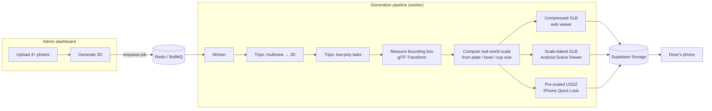

<div align="center">

# 🍽️ Augmented Menu

**A QR menu that lets diners place every dish on their table in AR, at its real size, before they order.**

Built from a handful of phone photos per dish: no 3D artist, no app install.


</div>

---

## The problem

Menus describe food with words and a flat photo. Diners can't tell if a "sharing plate" feeds two or four, or if a dessert is a bite or a slab. Restaurants that want 3D or AR menus today need a 3D artist for every dish and a native app nobody wants to download.

## The solution

Augmented Menu turns **4 phone photos** of a dish into a photo-real 3D model, scales it to the **dish's real measurements**, and serves it from a plain web link behind a table QR code.

| For diners | For restaurants |
| --- | --- |
| Scan a QR, browse a fast mobile menu | Create a menu in minutes from the admin dashboard |
| **One tap** opens native AR on iPhone (Quick Look) and Android (Scene Viewer) | Upload front / left / back / right photos and click **Generate 3D** |
| The dish appears on the table **at true size** | Set the size once (plate diameter, bowl, glass height…) |
| Works on any device: falls back to an interactive 3D viewer | See menu views, dish views and AR opens per dish |

---

## How it works



1. **Capture**: the admin uploads at least four photos (front, left, back, right) and enters one real measurement, e.g. *28 cm plate diameter*.
2. **Generate**: a background worker sends the photos to Tripo's multiview-to-3D API, then reduces the mesh to a mobile-friendly polygon budget.
3. **Scale**: the worker measures the model's bounding box and computes `scale = real size ÷ model size` along the axis that matches the measurement type.
4. **Package**: one model becomes three files: a compressed GLB for the browser viewer, a GLB with the scale baked in for Android, and a pre-scaled USDZ for iOS.
5. **Serve**: the dish page picks the best experience for the device. iPhone opens Quick Look and Android opens Scene Viewer in one tap; everything else gets a WebXR / 3D viewer.

---

## Engineering highlights

- **Accurate real-world scale.** Bounding boxes are computed with node transforms applied, because generated models often carry a root scale that would otherwise throw AR off. Each measurement type uses the right axis (diameter → X/Z, cups → Y), and models are re-centered so they sit *on* the table instead of sinking into it.
- **Retry-safe, cost-aware job pipeline.** 3D generation is slow and paid per task. Every Tripo task id is saved as soon as it's created, so a crashed or timed-out job **resumes by polling the existing task instead of paying again**. Input errors fail fast with `UnrecoverableError`, so they are never retried.
- **Race-free versioning.** Each generation claims a new version atomically, and all status updates are conditional on that version, so a slow older job can never overwrite a newer model. Old versions and their files are cleaned up once a newer one goes live.
- **Device-aware AR.** Native one-tap AR on iOS (`rel="ar"` USDZ) and Android (Scene Viewer intent with `resizable=false`), WebXR with hit-testing, surface placement and table-plane occlusion where supported, and an orbit 3D viewer everywhere else.
- **Fast public menu.** Menu data is cached and invalidated on every admin edit. Photos are served through `next/image` in AVIF/WebP at the size each phone needs. Database queries are backed by indexes on every foreign key.
- **Secure admin.** HMAC-signed, expiring session cookies (Web Crypto, shared by the Next.js proxy and route handlers), constant-time password checks, Redis-backed login rate limiting, safe post-login redirects, and a validated, size-capped, rate-limited public analytics endpoint.
- **Analytics.** A funnel from menu views to dish views to AR opens to placements, counted with SQL aggregates (`GROUP BY`, `FILTER`, JSONB) over a selectable date range.
- **Tested core.** `node:test` suites cover the scale math, session signing and expiry, input validation, the Android scale-baking transform, Tripo task resumption with a mocked API, and the job processor's success, retry, race and failure paths with injected fakes.

---

## Tech stack

| Layer | Tools |
| --- | --- |
| Web app | **Next.js 16** (App Router, Server Components, route handlers), **React 19**, **TypeScript**, **Tailwind CSS** |
| 3D / AR | **three.js**, **react-three-fiber**, **drei**, **@react-three/xr** (WebXR), AR Quick Look, Google Scene Viewer |
| 3D processing | **glTF-Transform** (bounds, dedup / prune / quantize, scale baking), **Tripo3D API** (multiview → 3D, low-poly, USDZ) |
| Data | **PostgreSQL** with **Prisma** ORM, **Supabase Storage** |
| Background jobs | **BullMQ** on **Redis**, separate worker process |
| Quality | ESLint 9, TypeScript strict mode, `node:test` + `tsx` |

## Project structure

```
src/
├── app/
│   ├── r/[slug]/                 # Public menu → dish page → 3D / AR viewer
│   ├── admin/                    # Dashboard, restaurant & dish editors, analytics
│   └── api/                      # Public, admin and analytics route handlers
├── components/                   # Design-system primitives and icons
├── lib/
│   ├── tripo.ts                  # Tripo API client with task resumption
│   ├── model-generator.ts        # Photos → GLB / USDZ / Android GLB
│   ├── process-generate-3d-job.ts# Versioned, retry-safe job processor
│   ├── scale.ts                  # Real-world scale math
│   ├── menu.ts                   # Cached public menu queries
│   └── session.ts, rate-limit.ts # Admin auth
├── jobs/worker.ts                # BullMQ worker entry point
└── proxy.ts                      # Guards /admin and /api/admin
prisma/                           # Schema and migrations
tests/                            # node:test suites
```

---

## Running locally

**Prerequisites:** Node 20+, PostgreSQL, Redis, a Supabase project (storage bucket), and a Tripo API key.

```bash
npm install
cp .env.example .env          # fill in database, Supabase, Redis, Tripo, ADMIN_PASSWORD, SESSION_SECRET
npx prisma migrate deploy
npx prisma db seed            # optional demo restaurant at /r/demo
npm run dev                   # http://localhost:3000
npm run worker                # in a second terminal: processes 3D generation jobs
```

Admin lives at `/admin`; a health check is at `/api/health`.

### Checks

```bash
npm run lint
npm run typecheck
npm test
```

---

## Roadmap

- Downloadable, print-ready QR codes per restaurant and table
- Multi-user admin accounts and per-restaurant roles
- Allergen and dietary tags with menu filters
- Multi-language menus

## Author

Built by **Khaled Al Daqrouq** · [GitHub @KDaqrouq](https://github.com/KDaqrouq)
